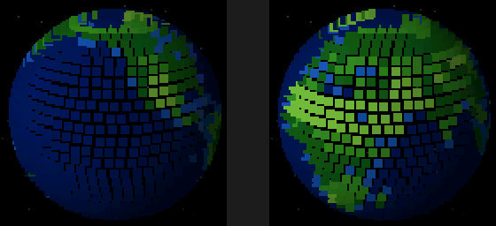
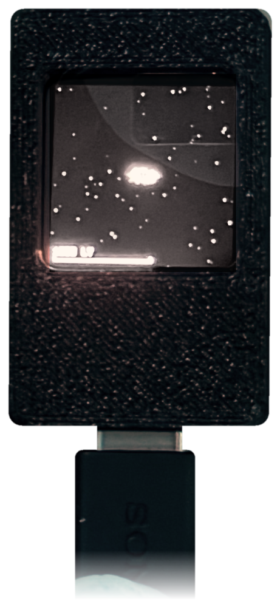
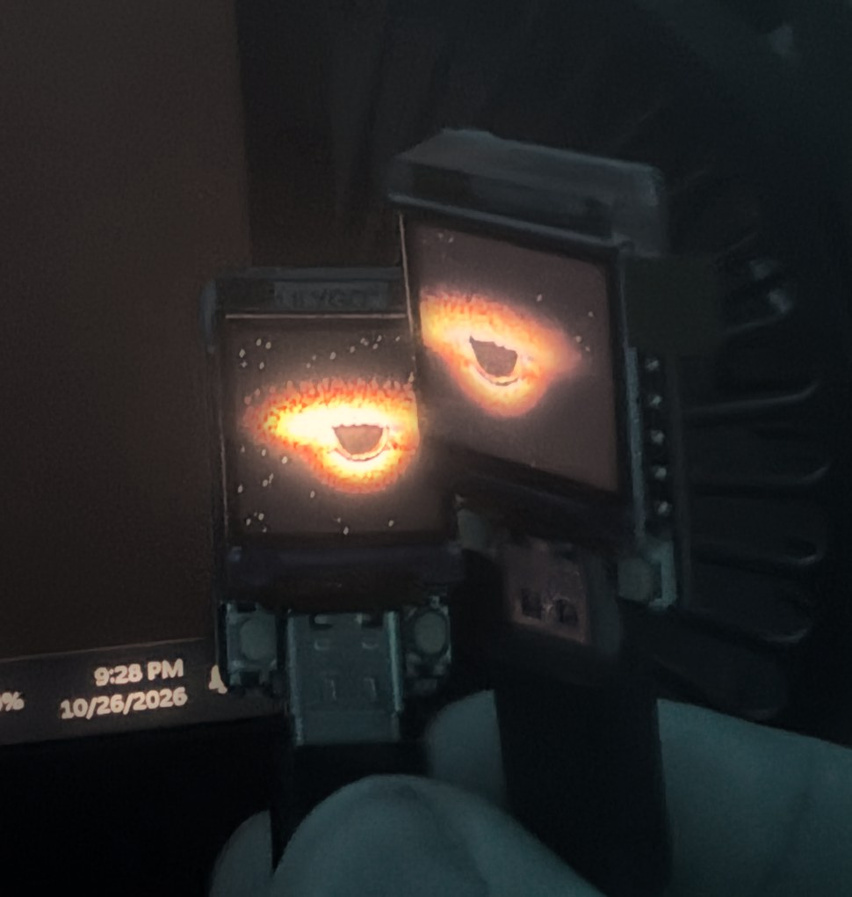
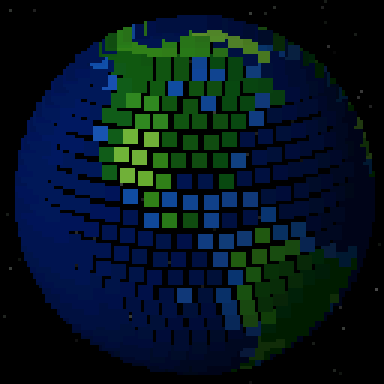
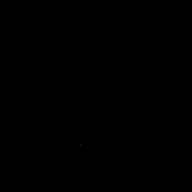

# Mini Galaxy

**Two tiny screens that know how close they are to each other.** Firmware for a pair of
LilyGO T-QT Pro boards (ESP32-S3, 128×128 LCD): each shows a turning pixel Earth, or a slow
zoom-out from the Earth to the Milky Way. Bring the two boards together and whatever is on
screen gets pulled into one black hole that spans both displays.

<p align="center"></p>

<p align="center">
  
  &nbsp;&nbsp;
  
</p>

The boards measure each other's distance using radio signal strength (ESP-NOW broadcast
packets, ~40/sec). No router, no Wi-Fi network, no internet, no extra libraries. Everything
is drawn procedurally on the ESP32 at 30 to 40 frames per second.

<p align="center">
  
  &nbsp;&nbsp;
  
</p>

## Which sketch?

| Sketch | What it does |
|---|---|
| `ProximitySpheres_SharedHole/` | **The main one.** A chunky-pixel Earth on each board. Bring the boards together and both Earths are torn apart into ONE black hole spanning both screens (the hole sits in the bezel gap, each board draws its half of the accretion disk). |
| `ProximitySpheres_Zoom/` | **The zoom.** Starts on the Earth and keeps zooming out at a steady pace: Moon, Sun and planets, Oort cloud, nearest stars, the whole Milky Way, then fades and repeats (7.5 minutes per cycle). A map-style scale bar sits at the bottom. Bring the boards together at any point and whatever is on screen falls into the shared black hole. |
| `PanelTest/` | Screen identification test. Run it once if the screen stays black or looks like a photo negative. |

Earlier looks are kept in `extras/`: rainbow spheres, a detailed Earth with clouds and city lights, one
black hole per board, and the original stretch-only spheres. They all share the same radio, button and
tuning code. Whichever you pick, flash the **same** sketch to **both** boards.

## One-time setup (Arduino IDE 2)

1. **Boards Manager** → install **"esp32 by Espressif Systems"**, **version 3.x**.
   (LilyGO's README says to use 2.0.14. That only applies to their TFT_eSPI examples. This
   sketch doesn't use TFT_eSPI and *needs* 3.x.)
2. Open `ProximitySpheres_SharedHole/ProximitySpheres_SharedHole.ino`.
3. **Tools** menu:
   | Setting | Value |
   |---|---|
   | Board | ESP32S3 Dev Module |
   | USB CDC On Boot | **Enabled** (otherwise Serial Monitor shows nothing) |
   | Flash Size | 4MB if your board is N4R2 · 8MB if N8 |
   | PSRAM | QSPI PSRAM for N4R2 · Disabled for N8 (the sketch doesn't need it either way) |
   | Erase All Flash Before Sketch Upload | **Enabled** for the first upload (wipes LilyGO's factory firmware), then Disabled |
   | Port | the board's COM port |
4. Upload to board #1, unplug, plug in board #2, then upload again. **Both boards get the same sketch.**

On boot each screen shows **red / green / blue bands with a white border** for about a second.
That checks the display. Then the sphere starts.

## Using it

- Power both boards (USB to the PC, a phone charger, or a power bank, all fine).
- Hold them side by side, screens level with each other, and move them together and apart.
- **Spheres reaching the wrong way** (away from each other)? Press **KEY** (right button) on either board. It flips both boards.
- **BOOT** (left button) toggles a debug overlay showing live signal strength (dBm), frames per
  second (the blue number under it), which board it thinks it is (L/R), a link light
  (green = sees the other board), and a proximity bar.

## Tuning

Signal strength depends on the room, how you hold the boards, and the antenna orientation. Turn on the
debug overlay and note the number:

- where you want the spheres to start reaching for each other → set `RSSI_FAR` (default -20)
- where you want the spheres to start falling into the black hole → set `MERGE_START_DBM` (default -17)
- where you want the black hole fully formed → set `MERGE_FULL_DBM` (default -13; touching boards read about -11 to -7)

The orange ticks above the debug overlay's proximity bar mark those last two points.

`FORM_SECONDS` (default 4) is the shortest time the black hole takes to form, however fast you push
the boards together. Pulling them apart undoes it at normal speed.

Expect the reading to jitter a few dB. The sketch filters it, but radio is not a precise ruler, so treat it
as a rough distance and not exact centimetres.

Other knobs at the top of `ProximitySpheres_SharedHole.ino`:

| Knob | What it does |
|---|---|
| `MERGE_START_DBM` / `MERGE_FULL_DBM` | signal strength where the spheres start merging / are fully a black hole |
| `FORM_SECONDS` | minimum time for the black hole to form |
| `GAP_PX` | how many pixels of bezel sit between the two screens; tweak until the disk lines up across the gap |
| `HOLE_RADIUS` | size of the event horizon in pixels |
| `REACH_AMP` | how far a sphere stretches toward the other before the merge |
| `SPHERE_RADIUS`, `RINGS` | Earth size and dot density (fewer rings = faster merge, default 36) |
| `SPIN_PERIOD_S` | seconds per Earth turn (default 60; keep it a divisor of 3600) |
| `SEA_*`, `LAND_*` | the two ocean blues and three land greens |
| `SUN_X/Y/Z` | where the sunlight comes from; more sideways = a wider dark side |
| `TX_POWER` | radio power; lower = more RSSI change per centimetre at desk distances |

## The zoom sketch

`ProximitySpheres_Zoom` runs a "powers of ten" cycle on both boards in sync. The Earth holds for ten
seconds, then the view zooms out at a steady rate (about 34 seconds per tenfold step): the camera hands
over to the Sun once it comes into view, and ends centred on our spot in the Milky Way (a blinking white
dot). Simulated time speeds up with the zoom, so the Moon and planets visibly move along their orbits.
The empty stretch between Neptune and the nearest stars goes by 1.6x faster. A scale bar at the bottom
shows a round distance in km, AU (Earth-Sun distances) or light-years; it hides while merging or when
the debug overlay is on.

The two boards share a clock so the cycle stays in step. Whichever board's clock is further ahead
wins, so flashing or rebooting one board doesn't restart the cycle on the other.

Knobs at the top of `ProximitySpheres_Zoom.ino`:

| Knob | What it does |
|---|---|
| `ZOOM_MINUTES` | length of one cycle (default 7.5; use 5, 7.5, 10, 12, 15, 20 or 30 so both boards wrap together) |
| `ZOOM_KEYS` | the timeline: at each fraction of the cycle, how wide the screen is (log10 metres) and how fast simulated time runs. Edit, add or remove rows to linger longer or skip faster |
| `VIEW_TILT` | how slanted the orbits look (1 = seen from straight above, 0 = edge on) |
| `PLANETS` | real orbit sizes, periods, radii and colours |

With the debug overlay on, the orange number is the zoom level: the screen width as a power of ten in
metres (7 = ten thousand km, 11 = Earth's orbit, 16 = a light-year, 21 = the galaxy).

Preview on the PC: `python sim/preview_zoom.py` writes `reference/zoom-cycle-preview.png` (12 moments
of the cycle) and `reference/zoom-merge-preview.png` (merging at three stages). Add a number from 0 to 1
to render a single moment, e.g. `python sim/preview_zoom.py 0.33`.

## The Earth map

The continents (and, for the detailed version, colours, clouds and city lights) come from `ProximitySpheres_SharedHole/earth_map.h`,
a 256 x 128 lookup table. It's generated by `sim/make_earth_map.py` from Natural Earth's
1:50m coastlines and lakes (public domain, naturalearthdata.com), saved in `sim/data/natural_earth/`.
On the screen one map cell is a bit over one degree, so the real coastlines are as sharp as this
display can show. To change the map, edit that script and run:

```bash
python sim/make_earth_map.py
```

It rewrites `earth_map.h` (copy it into `ProximitySpheres_Zoom/` and `extras/ProximitySpheres_EarthDetailed/` too) and `sim/earth_map.npz`, and saves a flat picture of the map to
`reference/earth-map-flat.png`. Then upload the sketch again.

## Previewing on the PC (no flashing needed)

`sim/` holds a Python port of the renderer, pixel for pixel. It draws both screens side by side
(with the bezel gap) at several proximity values and writes a PNG strip:

```bash
python sim/preview_sharedhole.py
```

Output goes to `reference/sharedhole-preview.png` (the merge, frame by frame in dBm) and
`reference/earth-rest-preview.png` (the resting Earths). Needs Python 3 with `numpy` and `pillow`.
`preview_earth_detailed.py` previews the detailed Earth, `preview_sharedhole_rainbow.py` the rainbow version, and `preview_sharedhole_v1.py`
the first version of the merge.
When you change a look constant in the sketch, change it in the preview too (same names).

`python sim/make_gifs.py` renders the demo animations in `docs/` (the merge, the turning Earth and the
whole zoom cycle) from the same simulators.

## Troubleshooting

| Symptom | Fix |
|---|---|
| Screen stays white/black/garbled, but Serial Monitor shows output | Upload **`PanelTest/PanelTest.ino`**. It cycles through all 3 panel types and both backlight settings, showing 1–6 white bars. Note which bar count gives a clean picture, then set `PANEL_VERSION` / `BACKLIGHT_ON` to match (the Serial Monitor tells you which values) |
| Colours look like a photo negative | Wrong panel version, so try the other one |
| Image is 1–2 px shifted, garbage line on an edge | Adjust `COL_OFS` / `ROW_OFS` in `tqt_display.h` |
| Sphere looks upside down vs. the USB plug | `#define FLIP_SCREEN 1` |
| Upload fails / COM port disappears | Hold **BOOT**, plug in USB, release, then upload again |
| Compile error about version 2.x | Update the esp32 board package to 3.x |
| Link light stays red | Both boards must run this sketch. Keep `ESPNOW_CHANNEL` the same on both |
| The disk doesn't line up across the gap | Adjust `GAP_PX`; hold the boards with the screens level |

## Files

- `ProximitySpheres_SharedHole/`: main sketch (radio link, shared clock, two Earths + one black hole) and its `earth_map.h`
- `ProximitySpheres_Zoom/`: the zoom-out cycle (Earth to Milky Way), same radio link and black hole
- `PanelTest/`: screen identification test (run it if the screen is black)
- `*/tqt_display.h`: minimal display driver for the T-QT Pro screen (pins and init from LilyGO's repo), identical copy in each sketch folder
- `sim/`: PC simulators of the sketches, the Earth map generator and the demo-animation script (Python); `sim/data/` holds the Natural Earth map data
- `docs/`: demo animations and stills rendered from the simulators, plus the edited photos
- `reference/`: preview strips rendered by the simulators
- `case/`: printable case (OpenSCAD source, STL and 3MF)
- `extras/`: earlier looks, with their previews and simulators
- `photos/`: the original photos of the boards running

## License

[CC BY-NC 4.0](LICENSE). Flash it, share it, modify it, publish your changes, all welcome with
credit. Don't sell it or sell boards or kits running it. For commercial use, get in touch.

## Credits

- Coastlines and lakes: [Natural Earth](https://www.naturalearthdata.com), public domain.
- Display pins and init sequence: [LilyGO's T-QT repo](https://github.com/Xinyuan-LilyGO/T-QT).
- The idea of two screens reaching for each other: "proximity spheres" by @adamfuhrer.
- The black hole look: the accretion disk from *Interstellar*.

