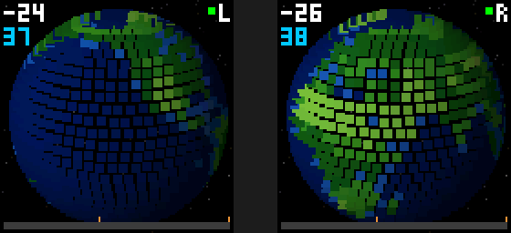

# Mini Galaxy

Firmware for two LilyGO T-QT Pro boards (ESP32-S3 with a 128x128 screen). Each board shows a
pixel Earth. Bring the two boards together and both Earths get pulled into one black hole that
spans the gap between the screens. A second sketch zooms out from the Earth to the Milky Way
over 7.5 minutes, and the black hole works at any point of the zoom.

<p align="center"></p>

The boards find each other over ESP-NOW and use signal strength as the distance. No Wi-Fi
network, no libraries beyond the ESP32 core.

<p align="center">
  
  &nbsp;&nbsp;&nbsp;
  
</p>

<p align="center"></p>

## Sketches

| Sketch | |
|---|---|
| `MiniGalaxy_Earth/` | The Earth and the shared black hole. Start here. |
| `MiniGalaxy_Zoom/` | Earth to Milky Way in 7.5 minutes, scale bar at the bottom, same black hole. |
| `PanelTest/` | Run this if the screen stays black or the colours look inverted. |

`extras/` has the earlier versions: rainbow spheres, a detailed Earth with clouds and city lights,
one black hole per board.

## Flashing

Arduino IDE 2 with the **esp32 by Espressif Systems** core, version 3.x (not the 2.0.14 that
LilyGO's examples ask for). Board settings:

| Setting | Value |
|---|---|
| Board | ESP32S3 Dev Module |
| USB CDC On Boot | Enabled |
| Flash Size | 4MB (N4R2) or 8MB (N8) |
| Erase All Flash Before Sketch Upload | Enabled for the first upload, then Disabled |

Flash the same sketch to both boards. On boot you get a second of colour bars, then the Earth.

## Using it

Hold the boards side by side and move them together. Buttons:

- **KEY** (right): flip sides, if the Earths reach away from each other.
- **BOOT** (left): debug overlay. Signal strength in dBm, frame rate in blue, which side the board
  thinks it is, a link light, and the proximity bar with ticks where the merge starts and completes.

<p align="center"></p>

## Tuning

Signal strength depends on the room and how you hold the boards. Turn on the overlay, read the
dBm, and set these at the top of the sketch:

| | default | |
|---|---|---|
| `RSSI_FAR` | -20 | the Earths start reaching for each other |
| `MERGE_START_DBM` | -17 | they start falling into the hole |
| `MERGE_FULL_DBM` | -13 | the hole is fully formed (touching boards read about -10) |
| `FORM_SECONDS` | 4 | how long the hole takes to form, however fast you push |
| `GAP_PX` | 24 | bezel width between the screens, in pixels; adjust until the disk lines up |

In `MiniGalaxy_Zoom`, `ZOOM_MINUTES` sets the cycle length (use a number that divides 60 so both
boards wrap together) and `ZOOM_KEYS` is the timeline. The two boards keep a shared clock, so the
cycle stays in step and survives a reboot of either board.

## PC preview

The `sim/` folder has Python ports of both renderers (numpy and Pillow). They draw the same pixels
as the boards.

```
python sim/preview_earth.py      # merge sequence -> reference/
python sim/preview_zoom.py       # zoom cycle -> reference/
python sim/make_gifs.py          # the GIFs in docs/
python sim/make_earth_map.py     # rebuild earth_map.h from Natural Earth coastlines
```

The Earth map is a 256x128 table in `earth_map.h`, generated from Natural Earth 1:50m data in
`sim/data/`. Copy the regenerated header into each sketch that uses it.

## Case

`case/` has an OpenSCAD source plus STL and 3MF files for a two-part snap case. It doesn't give
access to the buttons yet.

## License

[CC BY-NC 4.0](LICENSE). Use it, share it, change it, with credit. No selling it or boards running it.

## Credits

- Coastlines: [Natural Earth](https://www.naturalearthdata.com), public domain.
- Display init: [LilyGO's T-QT repo](https://github.com/Xinyuan-LilyGO/T-QT).
- The two-screens-reaching idea comes from the "proximity spheres" by @adamfuhrer.
- The black hole is a nod to *Interstellar*.
